<div align="center">
  
  <h1>NBA 桌面直播条</h1>
  <p>把比分和文字直播，安静地放在桌面一角。</p>
  <p>Windows 10 / 11 x64 · 在线安装与轻量版 · Win7 SP1 兼容预览 · 暖白与炭灰双主题</p>
  <p><a href="https://github.com/james7whm/nba-live/releases">GitHub 下载</a> · <a href="https://gitee.com/james7whm/nba-live/releases">Gitee 国内下载</a> · <a href="#界面预览">界面预览</a> · <a href="#使用说明">使用说明</a> · <a href="docs/VERIFICATION.md">验证记录</a></p>
</div>

原生 Windows NBA 悬浮文字直播工具。默认 **360×110 DIP**，提供置顶、胶囊收展、球员统计和比赛回顾；没有声音、闪烁或滚动动画，直播更新不会抢走键盘焦点。

当前版本 **1.2.3**。[查看更新说明](docs/releases/1.2.3.md)。新用户建议选择在线安装包，原有本地配置与收藏继续保留。

| 形态 | 适用场景 | GitHub | Gitee 国内源 |
| --- | --- | --- | --- |
| **在线安装包（推荐）** | Win10／11 x64；检测组件，缺少时经确认从微软下载 | [下载 EXE](https://github.com/james7whm/nba-live/releases/download/v1.2.3/NbaLive-1.2.3-online-setup-win-x64.exe) | [下载 EXE](https://gitee.com/james7whm/nba-live/releases/download/v1.2.3/NbaLive-1.2.3-online-setup-win-x64.exe) |
| 现代轻量 ZIP | Win10／11 x64；须先安装 .NET 10 Desktop Runtime x64 | [下载 ZIP](https://github.com/james7whm/nba-live/releases/download/v1.2.3/NbaLive-1.2.3-lite-win-x64.zip) | [下载 ZIP](https://gitee.com/james7whm/nba-live/releases/download/v1.2.3/NbaLive-1.2.3-lite-win-x64.zip) |
| 现代免安装完整版 ZIP | Win10／11 x64；包含运行环境，解压即用、适合离线或不便安装组件 | [下载 ZIP](https://github.com/james7whm/nba-live/releases/download/v1.2.3/NbaLive-1.2.3-win-x64.zip) | 不上传带环境的完整版，节约容量 |
| Win7 兼容预览 ZIP | Win7 SP1／Win10／Win11 x64；需预装 .NET Framework 4.8 | [下载 ZIP](https://github.com/james7whm/nba-live/releases/download/v1.2.3/NbaLive-1.2.3-compatibility-preview-net48-win-x64.zip) | [下载 ZIP](https://gitee.com/james7whm/nba-live/releases/download/v1.2.3/NbaLive-1.2.3-compatibility-preview-net48-win-x64.zip) |

Gitee 代码由 GitHub 镜像同步；发行附件由 GitHub Actions 单独复制，**从 v1.2.3 起只同步在线安装包、轻量 ZIP、兼容 ZIP 和各自校验文件，不上传带环境的免安装完整版**，既有历史附件不自动删除。刚发布时可能有同步延迟，可查看 [Gitee 发行列表](https://gitee.com/james7whm/nba-live/releases)。两个渠道同名附件应有相同 SHA256，不要将平台生成的源码 ZIP 当作应用包。

### 首次安装与版本选择

- **在线安装包**自身不依赖 .NET。双击后检测 x64 的 .NET 10 桌面运行环境，最低组件版本为 10.0.13；已有合适组件时不下载，缺少时明确确认后从微软 HTTPS 地址下载、校验并打开安装器。运行组件的系统安装可能要求管理员授权；安装取消、失败或需要重启时停止后续应用安装，并提供重试或安装帮助，不自动重启电脑。
- 应用安装到当前用户的 `%LocalAppData%\Programs\NbaLive`，提供开始菜单入口和可选桌面快捷方式，可从 Windows 应用列表卸载；设置和收藏位于独立的 `%LocalAppData%\NbaLive`，卸载时保留。安装／卸载前请通过托盘退出应用。
- Windows 不自带 .NET 10 Desktop Runtime；已有 .NET Framework、普通 .NET Runtime、ASP.NET Runtime 或仅其他大版本不能代替它。轻量 ZIP 的组件可从 [微软 .NET 10 下载页](https://dotnet.microsoft.com/download/dotnet/10.0) 选择 **Desktop Runtime → Windows x64 Installer** 安装，无需 SDK。在线安装器面向 Windows 10 1809 及以后／Windows 11 x64，Win7 使用独立兼容 ZIP。
- 从旧完整版切换为轻量安装版：退出旧程序后运行在线安装器，原配置和收藏自动沿用；确认新版可用后再自行删除旧解压目录。不要将轻量 ZIP 直接覆盖到完整版目录。
- 轻量版／在线安装版的一键更新只获取轻量 ZIP；完整版只获取完整版 ZIP；兼容版只获取兼容 ZIP。组件版本不够时轻量更新会保留当前程序，提示使用在线安装器补齐组件。完整版在 Gitee 不提供新版附件，会尝试 GitHub。
- 在线安装器和主程序目前尚无可信代码签名，可能出现 SmartScreen「发布者未知」提示；安装包不会自动消除该提示。核对来源及 SHA256 后自行决定是否运行，无需关闭系统防护。

**本版新增：** 在线安装器、现代轻量 ZIP 和按形态匹配的更新通道；减少完整版语言资源及部分界面缓存。设置与托盘继续提供更新提醒和一键升级，只有点击「下载并更新」才下载、校验并重启。v1.2.1 及更早版本需手动升级一次，使用方式与恢复说明见 [应用更新](docs/UPDATES.md)。

## 功能概览

**新增兼容预览包：** 独立 `net48` 兼容包目标为 Win7 SP1／Win10／Win11 x64，需要先安装 .NET Framework 4.8 或兼容的后续 4.x 运行环境。当前已完成 Win11 上的双运行时回归，尚未完成 Win7／Win10 实机验收；Win10／Win11 优先使用现代版。选择方式及完整条件见 [系统兼容说明](docs/COMPATIBILITY.md)。

| 功能 | 可以做什么 |
| --- | --- |
| 文字直播 | 优先主播解说、赛况实录、实时最新／完整补播；保留会话历史 |
| 悬浮与胶囊 | 角落吸附、置顶、快捷隐藏、鼠标穿透；胶囊悬停展开 |
| 展开阅读 | 最新消息在上，向下看旧记录；更新时保持阅读位置，一键返回最新 |
| 球星与阵容 | 最多关注 3 人并轮换球员卡；查看双方场上五人与首发参考 |
| 技术统计 | 首发球队色球衣、在场红球与红字、统计增量、列预设和组合筛选 |
| 球员单场详情 | 点击球员行查看全场／分节与加时统计、投篮落点、命中率及出手方式 |
| 应用更新 | 安静提醒、国内源优先、手动确认下载与一键升级、失败恢复旧版 |
| 球队得分 | 常规节／加时分节表，球队色累计比分曲线与时点比分提示 |
| 回顾与收藏 | 整理新增事件、查看本地规则摘要，手动收藏精彩原文 |
| 双主题 | 默认暖白、可选炭灰；30 支球队 Logo、自定义日历与统一窗口样式 |

### 快速开始

1. 从 [GitHub Releases](https://github.com/james7whm/nba-live/releases) 或 [Gitee 国内发行列表](https://gitee.com/james7whm/nba-live/releases) 下载适合系统的安装包／ZIP。在线版双击 EXE 按提示安装；ZIP 保留整个解压目录后运行 `NbaLive.exe`。完整版无需安装组件，轻量版需 .NET 10 Desktop Runtime x64，兼容版需 .NET Framework 4.8。应用本身按普通用户运行。
2. 选择一场比赛，点击「查看文字直播」。鼠标移入卡片即可使用文字／球员／阵容切换、回顾和更多菜单。
3. 在「更多 → 设置 → 外观」切换主题、字号、宽度、不透明度或胶囊模式，保存后生效。

| 默认快捷键 | 操作 |
| --- | --- |
| `Ctrl+Alt+H` | 隐藏／恢复全部应用窗口，隐藏期间仍取数 |
| `Ctrl+Alt+L` | 开启／关闭鼠标穿透 |

开启穿透后可通过快捷键或系统托盘恢复操作；快捷键可在设置中修改。

## 界面预览

以下均为**当前 WPF 程序实际渲染的界面截图，使用虚构演示数据**，不代表真实比赛、球员数据或实时服务状态。截图展示窗口内容；系统标题栏与桌面背景未包含在内。

### 悬浮直播与胶囊

普通卡片显示比分、节次和最近两条动态；胶囊收起为 **280×30 DIP**，悬停后展开。

<table>
  <tr><th>暖白 · 默认</th><th>暗黑 · 炭灰</th></tr>
  <tr><td></td><td></td></tr>
  <tr><td></td><td></td></tr>
</table>

### 展开历史、关注球员与场上五人

展开后最新消息在顶部，滚动阅读旧内容时保留位置；点击「返回最新」回到顶部，收起后恢复实时更新。球员卡和阵容可从内容菜单切换。

<table>
  <tr><th>暖白</th><th>炭灰</th></tr>
  <tr><td></td><td></td></tr>
  <tr><td>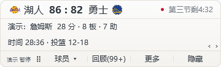</td><td>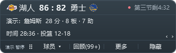</td></tr>
  <tr><td>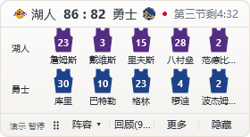</td><td>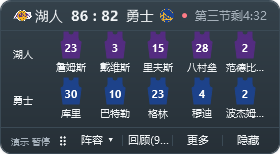</td></tr>
</table>

### 选择比赛

球队 Logo、比分和比赛状态集中展示；进行中比分及节次为红色，已结束场次仅胜方比分加粗。

<table>
  <tr><th>暖白</th><th>炭灰</th></tr>
  <tr><td>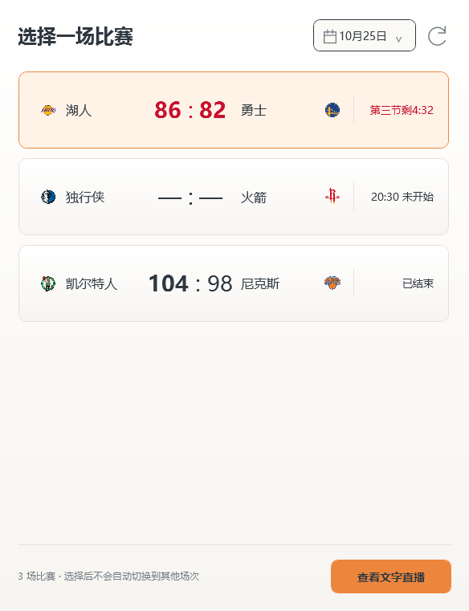</td><td>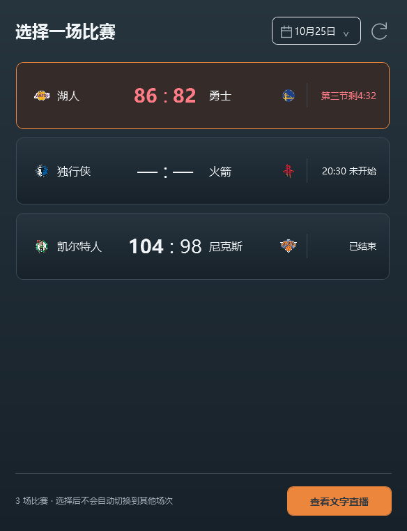</td></tr>
</table>

### 球员技术统计与球队得分

统计支持「场上五人＋只看关注」组合筛选，合计始终为全队。得分图用球队主色区分双方，悬停可查看记录时间和比分。

<table>
  <tr><th>暖白</th><th>炭灰</th></tr>
  <tr><td>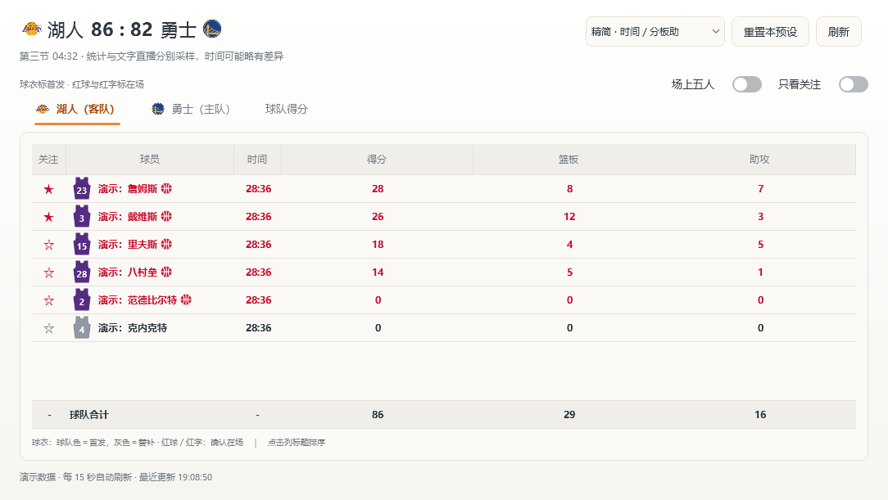</td><td>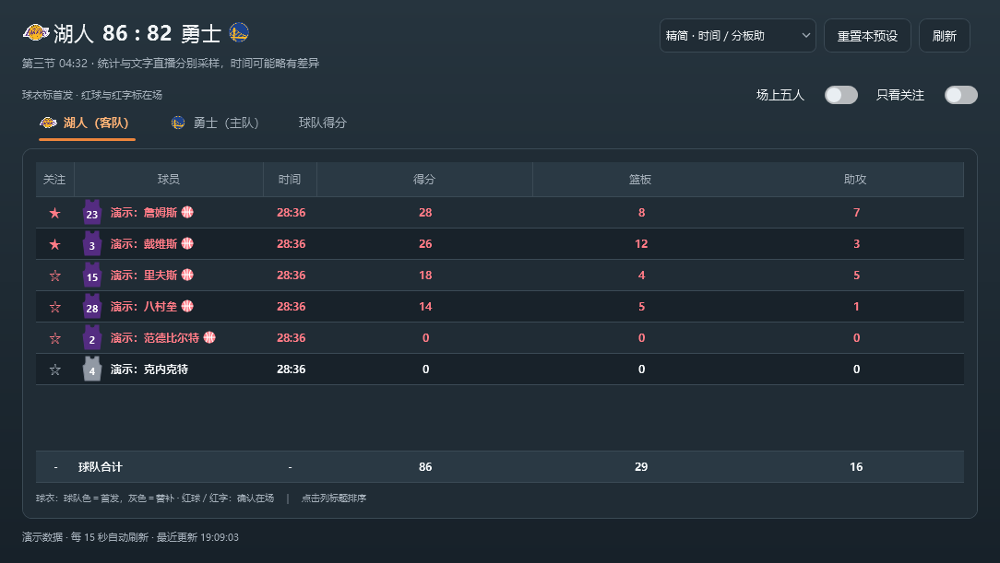</td></tr>
  <tr><td>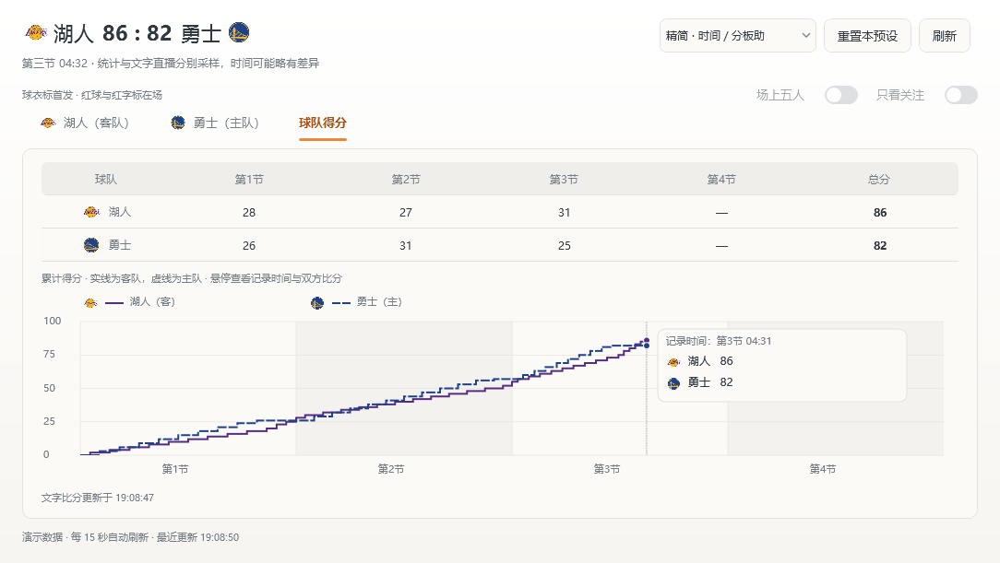</td><td>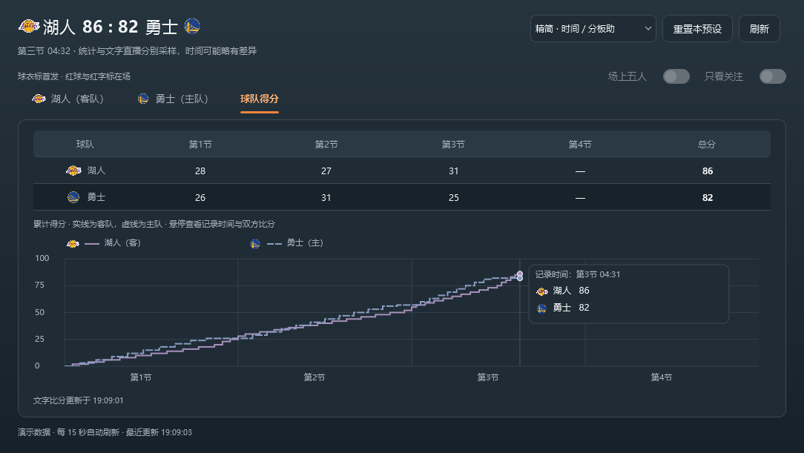</td></tr>
</table>

### 主题化日期选择器

可翻月、切换月份／年份、回到今天，也支持键盘操作。选定日期才刷新赛程，浏览月份不会请求数据。

<table>
  <tr><th>暖白</th><th>炭灰</th></tr>
  <tr><td></td><td>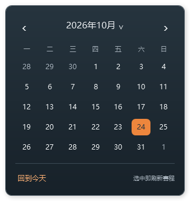</td></tr>
</table>

<details>
<summary>更多界面：设置、事件回顾与精彩收藏</summary>

设置保存主题和外观偏好；回顾在阅读期间保持固定；收藏仅保存手动选择的事件。

<table>
  <tr><th>暖白</th><th>炭灰</th></tr>
  <tr><td>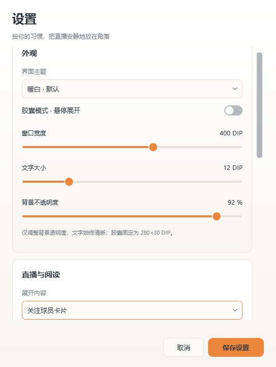</td><td>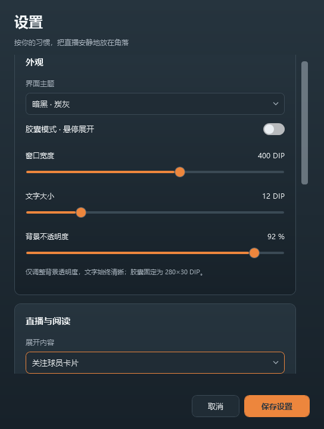</td></tr>
  <tr><td></td><td>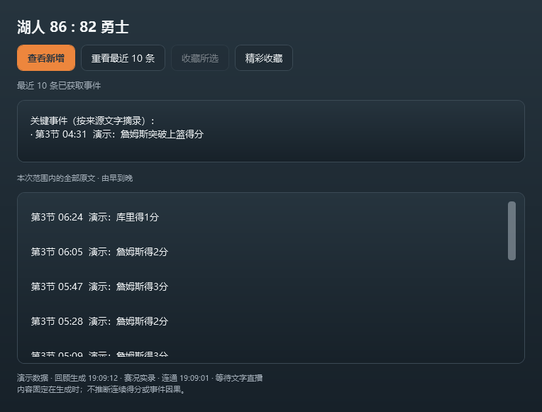</td></tr>
  <tr><td>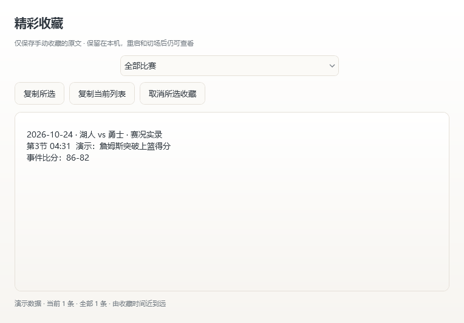</td><td>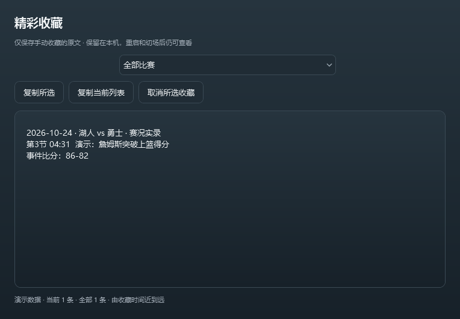</td></tr>
</table>

</details>

> 数据来自外部服务，可能受到更新延迟、限流或结构变更影响；进行中比赛的 30 分钟 App 人工对照尚未完成。测试范围与已知限制见 [验证记录](docs/VERIFICATION.md)。

## 使用说明

1. 解压下载的 Windows x64 压缩包到任意可写目录，运行其中的 `NbaLive.exe`。整个目录一起保留，无需安装 .NET，也无需管理员权限。
2. 选择当天比赛，单击「查看文字直播」。也可选择其他日期查看文字实录。
   比赛列表中，进行中的双方比分及节次／剩余时间显示红色，例如「第三节剩8:50」或「加1剩4:30」；球队名称保持普通样式。中场、节间或未提供时间时保留来源状态，不推算倒计时。列表打开时及每 60 秒读取一次页面，也可手动刷新，因此显示的是最近一次取样的比赛时间。已结束比赛恢复普通颜色，仅将胜方比分加粗；平分或缺少任一方比分时不标记胜方。
   未选比赛时，悬浮条显示浅灰赛程图标、简短说明和「选择比赛」圆角按钮，点击按钮或说明文字均可打开列表；仅比分模式使用单行紧凑布局，胶囊显示「选择一场比赛」。悬停只显示拖动、更多和隐藏，不重复显示选赛或暂停提示。关闭列表后仍可从这些入口重新打开。通过「更多 → 选择比赛」或托盘打开时，会恢复已最小化的比赛列表并带到前台。
3. 鼠标移入直播条，下方出现拖动柄、文字／球员／阵容切换、回顾、更多、隐藏，并暂停当前已有比分与内容的显示。选赛、历史、球员统计和设置在「更多」中，也可切换文字来源与展示方式。后台持续更新，移开后按展示方式恢复最新文字或继续补播；比分、球员与阵容恢复最新快照。
4. `Ctrl+Alt+H` 或直播条上的「隐藏」会同时隐藏直播条、选赛、统计、设置、历史、回顾及收藏窗口；恢复时还原此前可见的窗口及最小化状态，隐藏期间仍更新。隐藏时关闭展开的日历和下拉菜单，恢复不会自动展开它们。从托盘选择具体页面也会恢复应用并打开对应窗口。`Ctrl+Alt+L` 开启／关闭鼠标穿透，默认关闭。
5. 开启穿透后，使用快捷键或系统托盘菜单恢复交互。托盘双击可显示／隐藏，右键提供所有操作和「退出」；右键直播条也可打开相同菜单。托盘图标可能位于 Windows 的折叠区域。

设置支持宽度 280～480 DIP、字号 11～16 DIP、背景不透明度 20%～100%，不会降低文字自身的不透明度。快捷键支持 Ctrl、Alt、Shift 与字母、数字、F1～F24；冲突会在设置中提示。位置按物理屏幕坐标保存，多显示器断开后会限制到可见区域。拖动到角落附近可吸附。

文字显示模式包括：仅比分（58 DIP 高）、比分＋一条动态（84 DIP 高）、比分＋两条动态（默认 110 DIP 高）。修改大小时保留所在角落；位置不便操作时，可从托盘选「回到当前屏幕右下角」。重复启动会显示已运行的窗口，不会创建第二个订阅。

比分后显示来源提供的节次与剩余时间，例如「第四节剩11:50」「加时1剩4:30」；中场休息、赛前和已结束保持对应状态，未提供时钟时不推算倒计时。

文字模式的比分行右侧有上箭头，可把当前卡片向上展开到 320 DIP，直接滚动查看本次会话的全部原文；再次点击下箭头恢复原大小和位置。每次展开从顶部的最新消息开始，向下滚动查看更早记录，历史列表持续接收新消息；滚动查看旧记录时保持原来的阅读位置，点击「返回最新」回到顶部。展开期间离开鼠标保持展开；主动收起时立即恢复最新快照并持续更新，下一次移入卡片才重新悬停暂停。普通两行卡片仍保留悬停暂停，左下角显示「暂停」或新增数量，点击该提示可显示最新，移开鼠标恢复自动更新。仅此展开列表倒序展示，会话历史、回顾与补播继续保留原有时间顺序。仅文字模式提供此按钮，球员卡和场上五人不显示。切场、切换文字来源或内容类型时收起；展开不改写保存的普通尺寸与位置，也不增加取数请求。胶囊展开查看历史后保持阅读卡片，主动收起后恢复原有悬停收缩行为。

默认使用「优先主播解说」和「实时最新」：收到消息直接显示最近一／两条，最新在上；全部原文进入会话历史和回顾。首次同步按游标补齐历史，显示同步状态，完成前不把旧消息计为新增。没有主播时标注原因并自动回退「赛况实录」，每 60 秒重新检查；已连接主播暂时断网时保留原文并重试。

实时最新模式下，普通两行卡片使用悬停阅读快照，展开历史持续接收新消息并保持滚动位置。胶囊重新展开、从历史收起、隐藏后恢复或切回普通模式时，不沿用先前缓存的两行。普通悬停时显示「暂停」或「停+N」，点击提示可查看最新，鼠标离开后恢复自动更新；展开历史时显示「历史」或「+N」，也可使用「返回最新」。完整补播仍按队列展示较早消息，与展开记录顶部可能不同，不因查看记录而跳过待播内容。

可在更多、内容菜单、设置或托盘中改为「完整补播」：后续新增依次分页展示，每页至少 4 秒；修正不重复入队，迟到事件也补播。悬停、隐藏、胶囊收起、仅比分或其他内容时暂停补播，恢复后保留剩余阅读时间。切换展示方式从最新边界开始，不清除历史和回顾。比分与节次始终是最近快照，可能领先于补播事件。

积压较多时，可点击悬停工具栏左侧的「待播 N」，或从「更多／内容」菜单选择「跳到最新文字」；这只清空补播队列，历史、回顾及回顾未读数保留。主动更改重要事件／关注球员筛选时，重新从匹配的最新内容开始，随后新增按该筛选补播。

赛况实录可开启「只看得分、犯规、暂停和节次变化」。这是关键词筛选，可能遗漏或误判；主播解说保留全部原文，不应用重要事件和关注球员筛选。历史窗口始终保留全部文字。在设置的「关注球队」下拉框选择球队（含 30 队 Logo，无需手动输入），保存后该队比赛优先排在选赛列表前面，不会自动切场；选择「不设置」取消关注。旧配置中的已识别别名自动对应到球队，未识别值保留为「原有设置」。

「文字只看关注球员」可在内容菜单、设置或托盘中开关，默认关闭；先在统计表点 ☆ 关注最多 3 人。使用本场名单按球员 ID 确认对象，再匹配文字中的完整姓名或唯一简称，可显示得分、投篮不中、助攻、犯规及换人等相关事件。全名和简称有歧义时不猜测，译名差异也可能造成遗漏；没有关注、等待名单或关注对象不在本场时有明确提示。可与重要事件筛选叠加；比分仍正常更新，历史、回顾和其计数始终保留全部事件。

配置：`%LocalAppData%\NbaLive\settings.json`。保留外观、位置、快捷键、上次比赛、内容模式、关注球员和统计布局。历史窗口显示本次订阅获取的文字，由早到晚更新，保持阅读位置；切换比赛清空旧场次会话历史，不自动保存完整直播档案。手动收藏单独存放于 `bookmarks.json`。

## 球员技术统计

选择比赛后，点悬浮条「更多 → 球员技术统计／关注球员」或托盘的「球员技术统计」，打开独立阅读窗口。双方球队用页签切换，显示出场时间、得分、篮板、助攻、投篮、三分、罚球、抢断、盖帽、失误、犯规、前后场篮板、正负值和位置。首发／替补身份用姓名左侧球衣的颜色表示，没有单独的身份列。

球队合计以浅灰加粗行固定在表格底部，按列展示来源发布的球队统计；纵向滚动和球员排序不会移动合计行，横向滚动、调整列宽和移动列时保持对齐。合计行的关注、时间、位置和正负值显示 `-`；来源尚未发布合计时，整行数值显示 `-`，不将缺失值补为 0。

点击列标题排序；球员姓名列固定，窄屏可横向滚动查看其他列。自动更新保留排序、选择和阅读位置，切换当前比赛会清空旧场次数据。未出场球员保留来源说明，统计表缺失数值显示 `-`，不会当作 0。

**球员单场详情。** 点击球员行，或选中后按 Enter，可在右侧查看头像、全场／分节及加时统计、投篮落点、命中率与出手方式；关注星标仍只负责关注。球员身份和节次固定在顶部，下面独立滚动；窄窗口下使用整个统计内容区，通过「返回列表」或 Esc 返回。

命中用橙色实心点、未中用空心点，重叠点悬停可查看同位置记录。接口未提供逐球时间／单球出手方式时不推算；全场前后场篮板与缺失正负值沿用统计表并标明取样时间。两分由总投篮减去三分计算，未出手的命中率显示 `—`。关闭、切场、切换球队或进入球队得分页会取消详情请求；全局隐藏保留选择并暂停详情请求，恢复后刷新，主直播与原有统计继续运行。说明与限制见 [球员详情](docs/PLAYER-DETAIL.md)。

窗口右上角可选择三种列预设，默认「完整」：

- **精简**：球员、关注、出场时间、得分、篮板、助攻。
- **投篮**：球员、关注、出场时间、得分，以及投篮／三分／罚球的命中数-出手数和命中率。
- **完整**：全部原有统计，并包含三项命中率。百分比由对应命中数与出手数计算；未出手或数据缺失显示 `—`，球队合计使用球队命中数／出手数，不平均球员命中率。

各预设分别记住主客队的列宽、列顺序和主排序列／方向，跨切场与重启保留；关注与球员列固定在前面，合计随可见列同步对齐。旧配置中的首发／替补列与对应排序会自动移除，其他布局继续保留。「重置本预设」恢复当前预设双方的默认布局，不影响其他预设。

统计表和关注球员卡的得分／篮板／助攻显示最近两次成功取样的变化，例如 `28（+2）`。首次加载、新出现的球员或上次数值缺失时不补算增量；下调显示 `27（修正 -1）`。断网和加载中保留上次成功比较，恢复后与最近成功取样比较；下一次成功取样没有变化时清除旧增量。变化可能包含多条事件或来源修正，不代表单次进攻。悬停球衣或球员卡可查看比较时间与完整数据，合计行仅显示来源总数。

统计表中，球员姓名左侧显示带号码的球衣：本场首发固定为球队色，替补固定为灰色，与实时在场无关；首发下场不会变灰，替补上场也不会变为球队色。首发身份来自本场统计，悬停球衣可查看首发／替补身份、未出场说明、在场依据和统计变化。

已确认在场的球员姓名后显示自绘红色篮球，该行姓名与统计文字统一为红色；选中时使用浅红底保持清晰。换下场或在场状态无法确认后自动移除篮球、恢复普通文字，球衣配色保持首发／替补身份。赛前、赛后或尚无有效在场名单时不显示实时红球／红字；固定球队合计保持原样。长姓名省略时预留篮球空间，悬停姓名可读全文。

30 支球队按队徽主色配置独立色号；相同主色做轻微调整以保证色号不重复，号码根据底色自动使用黑色或白色。悬停球衣可查看号码、首发身份和配色色号。完整色表见 [球队配色](docs/TEAM-COLORS.md)。

号码按球员来源 ID 从当前球队名单读取，支持 `0` 和 `00`；未知号码显示 `-`，历史比赛的球衣号码可能与当前名单不同。球队名单缓存 6 小时，读取失败至少间隔 1 分钟再试；与比分及统计共用 HTTP 请求通道，号码不可用时仍保留统计数据。

统计窗口打开、选择「场上五人」、启用有关注对象的球员卡或关注文字筛选时，进行中每 15 秒、赛前每 30 秒获取数据；没有消费者后停止。所有视图共享单个统计订阅，使用现有数据接口；胶囊收起或快捷隐藏不会停止当前内容所需的取数。比赛结束或取消后停止自动刷新，可在统计窗口点「刷新」手动复查。与文字直播共用同一个请求通道，网络失败按 5／10／20／30 秒退避重试、保留最近成功的数据和更新时间；数据不可用时显示异常状态，可稍后刷新。统计与文字分别采样，比分／时间可能略有差异；统计窗口顶部始终使用该统计快照自身的比分。

## 球队分节得分与走势

统计窗口切换到「球队得分」页签，上方显示双方第一至第四节、本场已出现的各次加时以及总分；正在进行的节次显示目前已取得的本节得分，尚未开始或缺少分节边界时显示 `—`。分节来自本场文字记录的累计比分与节间边界，不把缺失数据补为 0。

下方使用双方球队主色绘制累计得分阶梯折线，客队实线、主队虚线，横轴按常规节 12 分钟、加时 5 分钟排列，纵轴为累计得分。鼠标移入图表可查看十字定位、对应文字记录的节次／剩余时间及双方比分；同一时间连续罚球以该时间最后一条比分为准。点击图表后也可用左右方向键逐条浏览，Home／End 定位首末记录。未取得的时段不补画，记录缺口处断线；总分暂时领先于文字记录时会提示差异，曲线不作平滑或推算。

图表复用当前比赛的文字订阅及球队配色，不增加网络请求。切场清空旧图，断网保留最近已取得的文字比分并显示更新时间；不写入长期得分档案。正式数据与 `--demo` 隔离，演示图中的分节和得分过程均为明确标识的虚构内容。

## 球星盯梢、胶囊和回顾

- **球员卡**：在统计表点 ☆，可跨球队按顺序关注最多 3 人。悬浮条切换到「关注球员」后显示得分／篮板／助攻，以及出场时间和投篮；悬停可查看其他统计。每 8 秒轮换，悬停暂停，‹／› 可手动切换。未出场和本场没有数据会明确提示，不自动更换关注对象。
- **场上五人**：内容菜单、设置或托盘可切换，显示双方两排带号码的球队色球衣，展开高度 154 DIP；悬停单件球衣可读完整姓名、统计和名单依据。开赛初、赛前和赛后可按本场完整首发名单回退，并在队名下标「首发」。比赛中途不完整、歧义、跨节尚无名单、文字连接中断或较旧时显示「阵容未确认」，不补齐猜测。悬停固定阵容，移开恢复最新；不是球场位置或攻防站位图。
- **胶囊**：设置、「更多」或托盘可开启，默认关闭。平时 280×30 DIP、单行比分，悬停 100 毫秒展开为配置宽度×110 DIP，阵容模式为 154 DIP 高；离开 250 毫秒收起。菜单和提示显示时保持展开，临时展开不改写保存的位置。
- **刚才发生了啥**：点击「回顾」或托盘对应入口。首次显示最近 10 条已获取事件，此后整理上次回顾后收到的新增记录；角标为新收事件数，与文字待播数量独立。没有补播积压时，悬停左侧的「停+N」表示悬停后新增数。来源修正不会增加未读数，迟到收到的事件会计入。
- 回顾展示当前比分、与上次回顾的比分前后对照、最多 5 条关键事件摘录和本次范围内的全部原文。采用本地规则，不调用 AI，不推断连续得分、领先变化或因果关系；网络接收时间也不等于事件实际发生时间。
- 回顾生成后保持固定，阅读期间不跳动；可点「查看新增」获取后续内容，也可重看最近 10 条。首次快照成功显示后建立回顾起点，此后只标记实际显示范围已读，生成后到达的事件继续累计；切场或重新选同一比赛会重置回顾，重启后不保留已读进度。

## 精彩收藏

历史窗口点击事件左侧的 `◇` 即可收藏，`◆` 表示已收藏；也可在回顾中选中原文后点「收藏所选」。收藏不改变历史、回顾范围或未读计数。

通过「更多 → 精彩收藏」、托盘、历史或回顾窗口打开独立收藏列表。按收藏时间由近到远显示，可按比赛筛选、复制所选、复制当前列表为纯文本，以及取消所选收藏。文本包含比赛日期、对阵、原文和事件比分快照，离线也可查看。

仅手动收藏的事件保存在 `%LocalAppData%\NbaLive\bookmarks.json`，切场和重启后仍保留。同一比赛的同一事件身份去重；后续会话收到该事件的来源修正时更新收藏原文并标记，不增加一条收藏；从较早的回顾收藏时优先采用已知的最新修正，回顾自身仍保持固定。只有文字而没有稳定来源身份的修正可能无法关联。写入失败保留原有收藏；文件损坏时保留原文件并显示状态，不以空列表覆盖。

## 数据与状态

读取数据源公开的 NBA 比赛中心与文字直播页面，进行中以 5 秒为请求启动间隔目标，扣除取数耗时，慢请求完成后不再额外等待完整 5 秒；赛前通常每 30 秒、预计开赛前 5 分钟起每 10 秒检查。网络与排队仍可能使实际间隔超过目标；同一数据源最多一个请求在途，排队的文字请求优先于统计、比赛列表与球队名单。单次文字请求限时 8 秒、其他页面 5 秒、可选球衣名单 2 秒，HTTPS 与回退请求共用该限时，名单失败不丢弃有效统计。比赛结束／取消停止轮询；重启仅自动恢复仍在进行的上次比赛。比赛列表打开时每 60 秒刷新。相同网页跳过重复 HTML 解析，内容无变化时复用历史列表；历史窗口使用虚拟化列表减少控件数量。

状态栏分别显示「连通」和「新事件」：前者是本机最近成功检查页面的时间，后者是本机最近发现新增条目的时间，不是事件实际发生时间。比赛暂停、节间休息没有新文字，不会据此判为断网。悬停状态提示可查看上次取数耗时（含排队）、本批新增数和补播说明。

主播消息使用 JSON 轮询，进行中遵循服务配置，最短间隔 1 秒；比分与节次独立以 5 秒为刷新目标，分别显示文字连通时间与比分快照时间。进行中的接口通常按最新在前返回，游标用于读取更早消息：初始化补齐后整体转换为由早到晚，每次刷新重新检查最新页，遇到大批新增或断网后的缺口时向前补齐到已有消息。已结束归档可能按最早在前返回；根据前驱身份或发布时间识别方向，保留相同时间内的服务顺序，兼容比赛结束时切换方向。分页每轮最多 60 秒，未完成时保留缓冲与游标继续同步；消息 ID 不用于数值排序，首次历史不计新增，修正不重复计数。比赛与直播间均结束后继续收取尾声，两次间隔 5 秒的检查没有新增消息才停止。

球员统计、阵容、走势图及赛况实录继续使用原结构化页面，不从主播解说推断统计。切换文字来源保留各自会话历史及回顾进度；选择赛况实录期间暂停主播请求，切回后检查最新页并补齐间隔中的新增；尚未完成的分页继续原有游标。原 HTML 快照可能延后批量更新，不能保证消除来源发布或缓存延迟。

主播消息使用 HTTPS；旧移动端赛程与比分接口在本机仅通过 HTTP 可用，限定为匿名只读。原页面 TLS 握手失败时仅对配置的数据源域名回退 HTTP；不发送 Cookie、账号或其他用户数据，不禁用证书验证，不执行页面脚本。设置显示打开设置时的传输方式；端点集中于 `SourcePages.cs` 与 `AnchorSource.cs`。

连接中断时保留最后一次成功的比分和文字，并显示最近更新时间；按 5、10、20、30 秒重试。无法识别页面显示「数据源异常」。没有比赛时明确显示空状态。网页结构变更可能需要更新解析器。

应用内不提供外部网页跳转；异常提示提供刷新建议。

**本地取数、静态解析与持续实时更新是不同验收项。请参阅 `docs/VERIFICATION.md` 中的实际验证结果。** 当前没有账号、视频、评论、多场轮播和开机启动。更新提醒与一键升级的使用及恢复方式见 [更新说明](docs/UPDATES.md)。

## 演示预览

命令行运行 `NbaLive.exe --demo`，使用明确标识的虚构数据，每 5 秒添加一条动态；不访问网络，配置与真实模式隔离。正式启动默认不会出现演示数据。真实模式与演示模式各限一个实例；同时运行时可给演示模式设置不同快捷键，避免注册冲突。

开发检查可加 `--settings`、`--statistics`、`--history`、`--recap`、`--bookmarks` 自动打开对应窗口，或加 `--inspect-overlay` 临时让悬浮窗口显示在任务栏以便可访问性工具定位；这些参数用于首次启动测试进程，默认启动不启用。搭配 `--demo-opening` 可预览开赛初首发参考转为换人名单，搭配 `--demo-finished` 可预览赛后首发；这两个参数仅在 `--demo` 模式生效，均为虚构数据。

`--demo --demo-picker` 可预览尚未选择比赛的初始界面，先打开演示比赛列表，选择后才开始虚构直播；`--demo-picker` 对真实模式无效，不会更改真实配置或订阅。

`--preview --game 168866 --history --recap --settings` 可检查当天真实数据，使用 `%TEMP%\NbaLive-Preview` 的独立配置，不修改正式设置。仅在 `--preview` 下处理指定比赛；编号不在当天列表时重新选赛。预览与演示共用独立实例锁，不同时启动。

## 开发与验证

需要 Windows 11 x64、.NET 10 SDK（`global.json` 固定 10.0.402，可滚动到兼容的较新特性带）。项目内的 SDK 如果存在于 `.tools/dotnet`，脚本优先使用；否则使用 PATH 中的 SDK。

```powershell
dotnet build src/NbaLive/NbaLive.csproj -c Release
dotnet run --project tests -c Release
dotnet run --project tests-ui -f net10.0-windows -c Release
dotnet run --project tests -c Release -- --probe
dotnet run --project tests -c Release -- --probe-statistics --game 168863
dotnet run --project tests -c Release -- --probe-anchor --game 168866 --date 2026-10-22
pwsh -File scripts/build.ps1
pwsh -File scripts/build.ps1 -ArtifactSuffix anchor-preview
```

自动测试使用独立控制台测试运行器，失败时退出码为 1；包含真实页面样本、加时、相同时刻多事件、乱序、修正、退避重试、取消和配置恢复。`--probe` 对当天实际网页进行联网解析。

有正在进行的比赛时：

```powershell
pwsh -File scripts/observe-live.ps1 -GameId 168863 -Seconds 1800
pwsh -File scripts/observe-live.ps1 -GameId 168866 -Seconds 1800 -Anchor
```

将编号替换为当天正在进行的比赛；加 `-Anchor` 观察主播通道。日志记录事件数量、最近事件、状态与比分，仍需与 App 或对应页面人工核对。已结束／未开始的场次返回非零退出码，不会当作直播验证通过。

应用运行后执行一小时资源采样：

```powershell
pwsh -File scripts/measure-resources.ps1 -Seconds 3600
```

采样保存在 `artifacts/resources-*.csv` 和 `.json`。CPU 百分比按整机逻辑处理器归一化，内存目标指进程工作集。资源测试需注明真实比赛、闲置或演示模式，不能互相替代。

## 结构

- `src/NbaLive.Core`：比赛模型、HTML 适配器、订阅状态机与配置。
- `src/NbaLive`：原生窗口、托盘、全局快捷键与 Win32 窗口行为。
- `tests`：可离线运行的场景测试、可选联网探针与观测工具。
- `tests-ui`：Windows WPF 阅读回归测试，覆盖双主题、普通／胶囊、千条历史滚动、批量新增、收起和返回最新；使用隔离演示数据，不改写用户配置。
- `scripts`：构建压缩包、直播观测与资源采样。

第三方依赖与许可见 `THIRD-PARTY-NOTICES.md`。

应用图标使用已确认的聊天气泡与篮球球纹设计：浅色圆角底座、深灰轮廓和暖橙色球纹。源文件为 `src/NbaLive/Assets/AppIcon.xaml`，程序与窗口使用完整图标，系统托盘使用透明背景的简化图形，并根据任务栏深浅色主题和 DPI 选取配色与尺寸；主题信息不可用时使用带底座的图标。修改后运行 `pwsh -STA -File scripts/build-icons.ps1`，可重新生成 16～256 像素的 9 档 ICO 和说明中的预览图；加 `-PreviewPath artifacts/icon-preview.png` 可生成实际尺寸的深浅背景对照图。随程序保留 `Tray.ico`、`TrayLight.ico`、`TrayDark.ico`。
