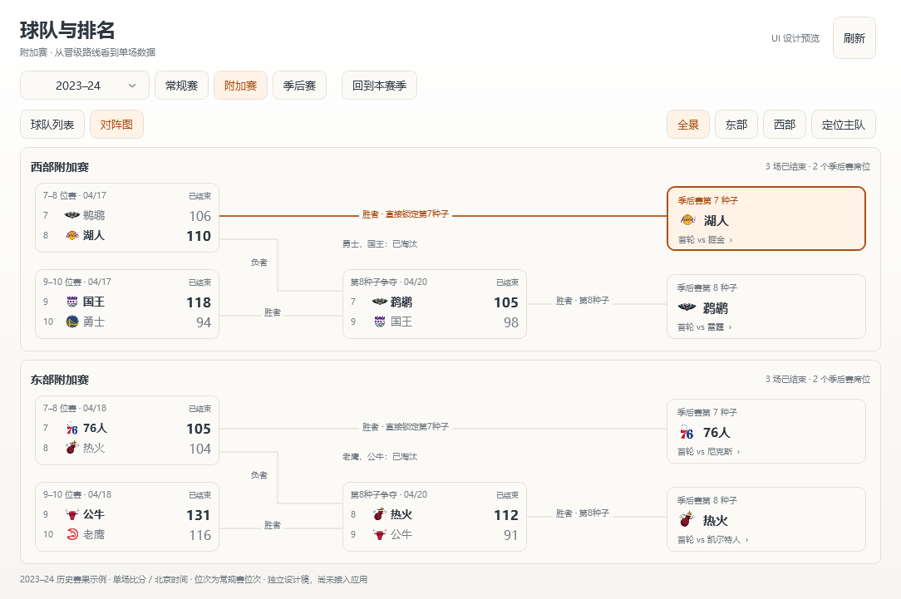
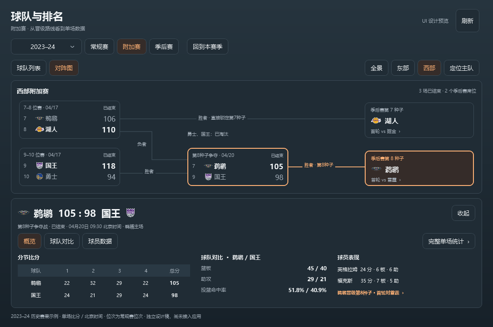
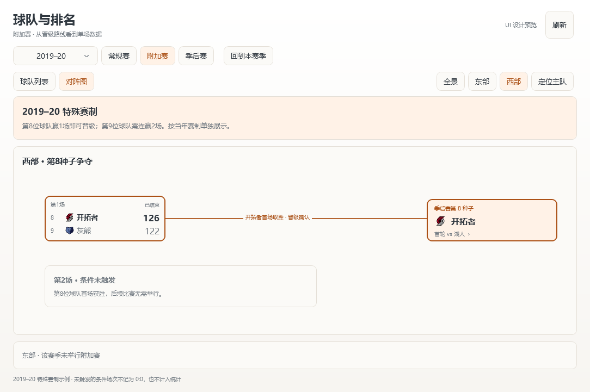

# 附加赛：对阵与单场数据 UI 方案

状态：已按确认方案并入原生 WPF，包含在1.3.0发布中。本页保留最初的独立设计图，当前实际界面和接入范围见 [附加赛说明](../PLAY-IN.md)。默认按现有球队窗口1100×760 DIP绘制，沿用暖白／炭灰、球队Logo、统一按钮和居中的赛季箭头。

## 入口与视图

在赛季旁增加「常规赛／附加赛／季后赛」三个独立阶段，选定赛季后同步切换整个内容区。附加赛首次默认对阵图，可切换球队列表；保留现有常规赛与季后赛的视图偏好，不用附加赛配置覆盖它们。浏览仍不切换正在订阅的直播比赛。

全景采用上西下东的两条路线，不将附加赛直接塞进完整季后赛树。每个分区从左到右为首轮比赛、最后一个席位争夺、最终出线球队。上方保留全景／东部／西部与定位主队，切换分区不改变赛季。

## 对阵卡片和晋级去向

- 左上：7–8 位赛，胜者锁定季后赛第 7 种子，负者仍有争夺第 8 种子的机会。
- 左下：9–10 位赛，负者淘汰，胜者进入第 8 种子争夺。
- 中间：前两场的负者／胜者交汇，胜者取得第 8 种子，负者淘汰。
- 右侧：分别展示第 7、第 8 种子席位、球队 Logo、名称与季后赛首轮对手。点击席位进入该赛季季后赛对阵，并定位对应系列赛。

卡片展示球队 Logo、常规赛最终位次、单场比分、北京时间日期和比赛状态；分数统一右对齐。比分为本场得分，不使用系列赛 1:0。常规赛位次与最终出线种子独立标明，例如 2024 湖人从常规赛第 8 位取得季后赛第 7 种子，不能把两者混用。

胜负路径以文字「胜者／负者」配合连线区分，不只依赖颜色。暖橙用于选中对阵、主队路径和对应出线席位；确定结果加粗，出局球队弱化但可读。未来对阵可按明确的当季规则显示「7–8 位赛负者」等位置标签，不预填胜者，不把预测对阵当成已发生比赛。未公布或无法核验的种子、比分与时间显示「待确认／—」。

## 点击单场后的数据区

点击比赛在图形下方展开详情，自动收为该分区视图，以保留图形和统计的阅读空间；收起后回到此前全景／分区及滚动位置。和当前季后赛详情一样，数据区位于内容区内，允许滚动，不覆盖对阵卡片。

顶部展示球队 Logo、单场比分、状态、北京时间、主客场和这场比赛的晋级结果。下方提供：

- **概览**：分节比分、双方核心统计、代表球员、晋级去向。
- **球队对比**：得分、篮板、助攻、抢断、盖帽、失误、犯规、投篮／三分／罚球及命中率。全部限定本场。
- **球员数据**：双方名单和本场技术统计，复用当前统计表的列、关注和球衣表达；历史已结束比赛不标记虚假的在场状态。
- **完整单场统计**：数据确认可用时打开对应比赛的详细统计；不能误用正在直播比赛的统计，也不凭名字猜测比赛映射。历史球员资料／分节／投篮详情仅在该场接口已核验后开放相应入口。

示例使用2023–24六场真实赛果。炭灰详情为鹈鹕105:98国王，分节、篮板、助攻、命中率和两位球员表现用于核对布局；这些本场数据已实际接入并在WPF窗口检查。归档姓名可能只提供原文，且尚未核验与实时球员编号的对应，当前不开放实时关注和球员投篮详情，避免错配；完整历史球员表可以查看。

球队列表使用「常规赛位次／球队／附加赛胜负／场数／结果」，结果包括第7种子、第8种子、淘汰、待定。点球队查看其本季附加赛赛程与场均；场均仅在该队全部相关单场数据完整且可核验时汇总，不复用常规赛或季后赛的场均表。缺失指标明确显示未提供。

## 2019–20 与无附加赛年份

2021 年开始的四队路径与 2020 年特别赛制分开处理。2019–20 仅在实际举行的分区展示两队争夺第 8 种子的规则：第 8 位球队赢 1 场即可，第 9 位球队需赢 2 场；只有触发条件时才可能举行后续比赛。

该设计示例中，开拓者首场 126:122 获胜后出线，第二场标记「条件未触发」，不伪造赛程、0:0 或两胜系列赛。东部明确显示「该赛季未举行附加赛」。更早且确认未设附加赛的年份显示「该赛季未设置附加赛」，与未开打、请求失败、数据缺失分别呈现；不能仅按空数组推断没有举办。

## 尺寸、状态与操作

- 内容宽度不足 1000 DIP 时默认单分区，保留东／西切换；再窄时使用「首场 → 第8种子争夺 → 出线」纵向卡片，字号不缩小。详情改为单列滚动，分节表数字仍居中。
- 方向键切换对阵，Enter 展开，Esc 收起；焦点不因刷新跳走。显示、隐藏和恢复保留所选赛季、分区、比赛和阅读位置。
- 初次加载及切换范围立即显示加载提示；网络失败保留同范围最近内容和成功时间。阶段尚未开始、该年未举办、资料缺失、条件未触发为不同状态。
- 窗口隐藏／最小化暂停本面板请求，恢复按现有缓存规则刷新。只为当前打开的比赛详情取数，不同时抓取六场完整技术统计；沿用已有请求通道和直播优先级。

## 数据接入与后续验收

已有归档样本包含 2024 六场附加赛赛果，当前解析器刻意将其从常规赛和季后赛中排除。实施时增加独立附加赛范围和账本，继续保证常规赛、季后赛统计不混入附加赛。旧阶段枚举值保持兼容，新阶段另赋值，不改变旧配置含义。

按赛季、明确阶段、比赛 ID、球队 ID 核验比分与对阵；双侧记录合并，大整数 ID 保存为字符串。2020 的阶段标签、举办条件及后续条件场次独立核验，不能把 2024 的字段和现代规则直接套用。六场赛果可作为初始样本，历史球队／球员单场接口、分节完整性与其他年份覆盖仍待验证。单场统计缺失时保留真实赛果，统计区域标明「本场详细数据暂未提供」，不以文字直播推算补齐。

开发验收包括六场赛果、四个出线种子、常规赛位次与出线种子区别、双侧去重修正、待定和条件场次、2020 独立布局、数据缺失、切比赛取消、旧配置、双主题、窄窗口及隐藏恢复。

### 核对资料

- [NBA 对 2020–21 赛季结构和附加赛规则的公告](https://official.nba.com/nba-announces-structure-and-format-for-2020-21-season/)
- [NBA 附加赛赛制历史说明，包含 2020 特殊规则](https://www.nba.com/news/nba-adopts-play-in-tournament-on-full-time-basis)
- [NBA 2024 附加赛赛程与赛果](https://www.nba.com/playoffs/2024/play-in-tournament/schedule)
- [鹈鹕对国王官方单场记录](https://statsdmz.nba.com/pdfs/20240419/20240419_SACNOP_book.pdf)
