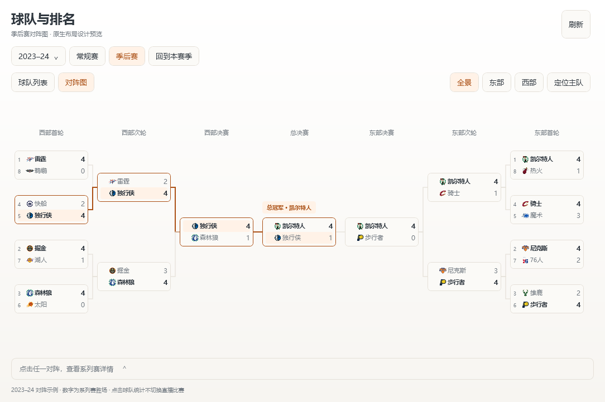
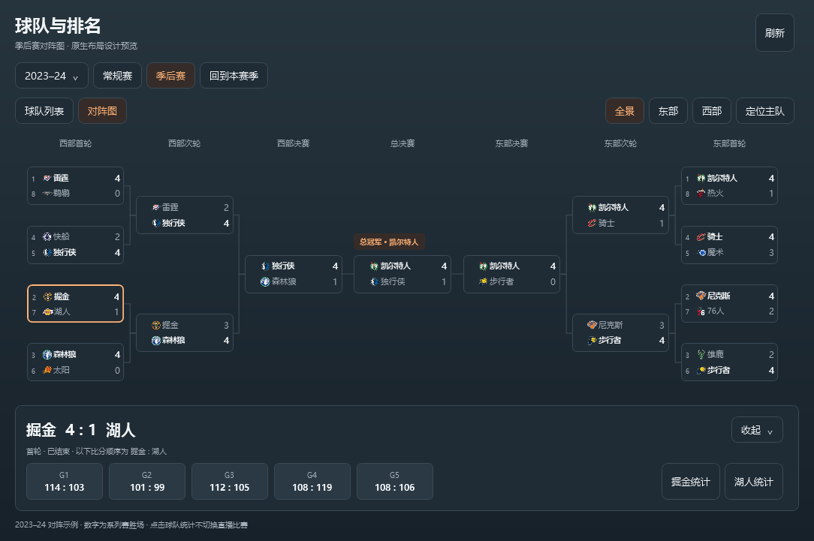

# 季后赛对阵图 UI 与实现

状态：已按确认方案并入原生 WPF，包含在1.3.0发布中。沿用现有暖白／炭灰主题、球队标识、暖橙点缀和无动画更新方式。

下方两图保留最初确认的独立设计预览。实际实现使用默认 1100×760 DIP，真实归档截图位于 README，交付包后缀为 `bracket-preview`。

## 入口与空间

仅在季后赛范围提供「球队列表／对阵图」切换，保留上次选择。现有赛季搜索、常规赛／季后赛与刷新入口保持可用。

对阵图使用整个内容区；上方为完整晋级路径，点击对阵后在底部展开系列赛详情。球队列表模式继续使用现有左表右详情，不把全联盟对阵图塞入半宽列表。

1100×760 DIP 的窗口中，图形按可用宽度排列，数字和短队名保持清楚。窄窗口改为东部／西部单区视图，并提供总决赛入口；内容仍不足时允许滚动，不将字号缩至难以阅读。切换图／表与全局隐藏恢复保留赛季、选中对阵和阅读位置。

## 全景对阵

全景从左右向中间汇聚：西部在左、东部在右、总决赛在中央。各自按首轮、次轮、分区决赛排列；轮次名称和节点数量以所选赛季实际赛制为准。

每个对阵卡片两行，展示球队 Logo、短队名、首轮种子和系列赛胜场，所有胜场数字右对齐。此处的 `4 : 1` 表示系列赛大比分，不是某场比赛的得分。长历史队名省略并提供完整提示，旧标识缺失时使用中性占位。

已经确定晋级的球队加粗，出局队保持可读的弱化颜色。已结束系列赛使用细实线连接；尚未确定的晋级位置显示「待确认」，不提前填入预测球队。暖橙色仅用于选中对阵及主动高亮的路径，避免所有连线同时抢眼。进行中状态用安静的小标记，不闪烁、不抢焦点。

工具栏提供全景／东部／西部和定位主队。定位主队使用设置中的主队，高亮其已确认晋级路径，不修改主队设置。主队未进入该季季后赛时明确提示，保留全景，不自动选择其他球队。

## 点击后的底部详情

底部详情是内容区内可收起的区域，不覆盖对阵节点：

- 标题展示双方 Logo、系列赛大比分、轮次与状态，右侧为收起按钮。
- 展示已确认的 G1、G2 等赛果，较多场次可横向浏览；统一注明比分顺序，避免主客场轮换造成比分误读。
- 点击某场查看北京时间、主客场和单场比分；未开始的条件场次明确标为待定，不伪造赛程。
- 提供双方「球队统计」入口，切回现有球队详情并保留赛季／季后赛范围，不切换正在订阅的直播比赛。
- 方向键移动对阵焦点，Enter 打开详情，Esc 收起底部区域；刷新时保留当前选中对阵。

图中的冠军以小型明确标签展示，不使用占据内容区的大型奖杯装饰。只有来源确认的最终结果才标记冠军。

## 数据与历史边界

复用现有季后赛完整账本和系列赛数据，以赛季、轮次与双方明确球队 ID 标识节点；同一系列赛双方的记录合并为一个节点。不能把双方各一份记录绘制成两组对阵。

连线必须对应已确认的晋级关系。完整归档可通过明确系列赛与后续实际参赛关系建立连接；进行中赛季未来节点若缺少来源明确的对阵关系，使用待确认状态，不仅根据常规赛排名猜测路径。种子与常规赛名次分开读取。

不以“先赢四场”作为所有年代的通用晋级条件；历史轮次、系列赛长度、轮空与参赛数量均需按当季资料验证。附加赛继续独立排除，不混入季后赛树和统计。

隐藏或最小化暂停窗口请求，显示后按现有缓存规则刷新；切换赛季取消旧请求，迟到响应不能替换当前图。加载、无数据、尚未开始、部分归档和刷新失败分别展示，失败保留同范围已成功的对阵图。

## 设计稿示例

使用 2023–24 对阵结构展示布局：两侧各八队向中间汇聚，中央总决赛为凯尔特人对独行侠。原设计暖白图展示独行侠的晋级路径，炭灰图展示选中掘金／湖人系列赛后的底部详情；实际界面已使用完整 82 场归档检查节点合并、晋级关系及系列赛比分，验证结果见 [验证记录](../VERIFICATION.md)。
